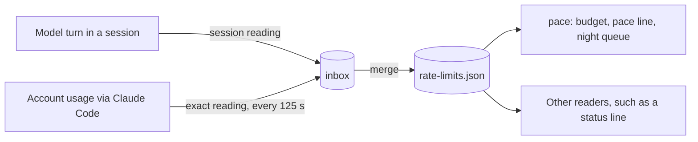
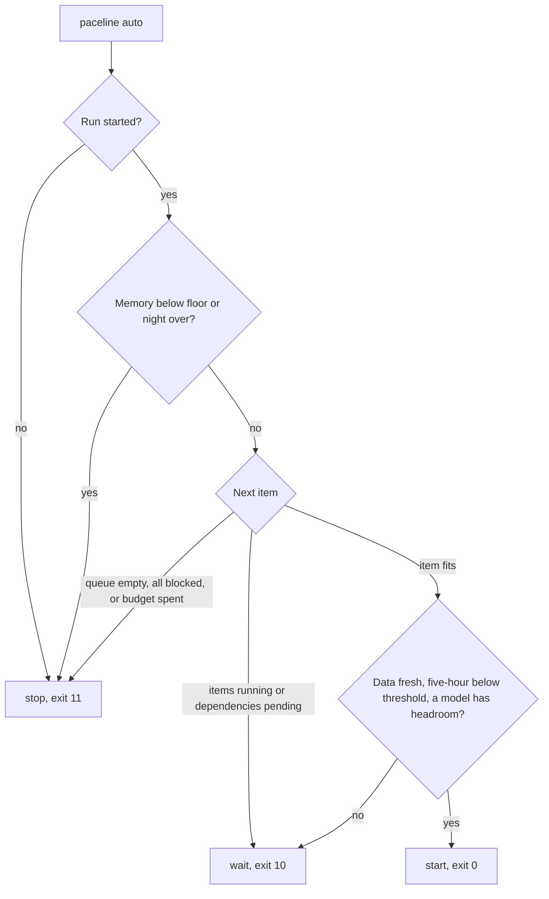

# How paceline works

This page explains where paceline's numbers come from and how pace turns them into a budget, a
recommendation, and the night queue's decisions. For the exact commands and keys, see the
[reference](reference.md). To try the budget with your own numbers, open the
[budget simulator](budget-simulator.html).

## Where usage readings come from

pace works from one file, the limits file `<state>/rate-limits.json`. Two kinds of reading reach it
through the inbox, `<state>/inbox/`:

- **Session readings.** With each model turn, Claude Code hands plugins the five-hour and weekly
  readings that the session's own request carried. paceline's module writes them to the session's
  inbox file when they change, and an unchanged reading at most once a minute. This part, the limits
  writer, is always on.
- **Exact readings.** While usage-watch is on, paceline asks Claude Code for the account's own
  usage, the figures `/usage` shows, with the model-scoped weekly limits. Claude Code adds the
  session's claude.ai login to the request; paceline never sees a token. The answer goes to
  `<state>/inbox/usage-watch.json`.

A merge takes the inbox into the limits file. It runs after every turn and at session start. While
a session is open, the module also checks the inbox every 15 seconds and merges any change. A pace
command merges first when the data is older than `usage_snapshot_max_age_sec` (300 seconds). The
`pace:` line before an Agent launch uses the limits file as it stands, without a merge.

### How usage-watch paces its requests

Every open session with paceline checks at its start and then every 10 seconds whether a request
is due: one is due when 125 seconds have passed since the last reading. The sessions of one Claude
Code configuration directory share that schedule through `<state>/usage-watch.state.json`, so one
reading serves them all. After an HTTP 429 answer,
usage-watch waits one interval; after any other error, it waits 10 minutes. The switch is read on
every check, so turning usage-watch on or off takes effect within 10 seconds, with no restart.

usage-watch needs a claude.ai login and an open session. When Claude Code gives no login for the
request, usage-watch sends nothing. While `CLAUDE_CODE_DISABLE_NONESSENTIAL_TRAFFIC` is set, Claude
Code refuses the request, and usage-watch records `network error`.

### Why the numbers can lag `/usage`

- A session reading arrives with the session's own request, so it trails the account by one
  request. It changes only when a session on this machine takes a turn. Usage from another machine
  or from claude.ai shows up after the next local turn.
- pace dates the limits file by its oldest live bucket. When that age passes `stale_threshold_min`
  (30 minutes), the data is `STALE`: the hard limits on the five-hour and weekly windows are
  skipped, and the night queue waits.
- With usage-watch on and any session open, the data is at most about two and a half minutes old:
  125 seconds between requests plus up to 15 seconds to the merge.
- For 15 minutes after an exact reading, session readings leave that bucket alone. The
  [inbox rules](reference.md#the-inbox-for-writers) give the full merge rule.

## Day, night, and off hours

Every wall-clock rule uses the profile's time zone. The weekly window ends at the reported weekly
reset and starts 7 days earlier. pace sorts each hour of the window into one kind:

| Kind | Hours by default | Budget |
|---|---|---|
| night | 00:00 to 08:00 (`night_hours`) | None; the night queue has its own allowance |
| weekday | Monday to Friday, 08:00 to 22:00 (`day_hours`) | Weight `weekday_weight` |
| weekend | Saturday and Sunday, 08:00 to 22:00 | Weight `weekend_weight`, within `weekend_cap_pct` |
| off | Every other hour, 22:00 to 24:00 by default | None |

Declared plans change the weight of day hours: an `away` plan sets it to 0, and a `heavy` plan
multiplies it by the plan's weight (`heavy_weight`, 2, by default). Where plans overlap, the later
declaration wins.

## The budget per hour

pace computes the budget in these steps:

1. **Effective weekly usage.** The weekly reading, or a model-scoped weekly bucket that matches
   the current model when that is higher. Model-scoped buckets come only from usage-watch, and only
   count when pace knows the model (`--model`, `PACELINE_MODEL`, or `ANTHROPIC_MODEL`).
2. **What is left.** 100% minus the effective usage.
3. **The reserve.** `reserve_pct` (8%) is held back until the last `reserve_decay_start` before the
   reset (Friday 18:00 by default). From then it falls in a straight line to 0 at the reset.
4. **Spendable.** What is left minus the reserve, never below 0.
5. **The split.** pace spreads the spendable share over the remaining day hours up to the reset, in
   proportion to each hour's weight. No hour gets more than its capacity,
   `five_hour_to_week_pct / 5` percent of the week (2% by default); what a capped hour cannot take
   goes to the others. When the spendable share covers every hour's capacity, each hour gets its
   capacity.
6. **The weekend cap.** The weekend day hours get at most `weekend_cap_pct` (20%) together, minus
   what the current weekend's day hours have already spent. Weekend nights are not counted against
   the cap. The rest goes to the weekday hours.
7. **The budget.** The share of the current hour, or of the next day hour with a weight above 0
   when the current hour is a night, off, or `away` hour.

The split starts from what remains now, so a past absence creates no lag to catch up.

The **norm** is the same split of `100 - reserve_pct` over the whole weekly window, without plans:
the even rate for a week used from start to end. `paceline status` shows the norm for the kind of
hour the budget belongs to, for example `budget 1.45%/h (weekday norm 1.03)`.

`paceline status` also warns when what remains of the week reaches `capacity_warn_ratio` (0.9) of
what the remaining day hours can spend at the day threshold: the remaining day hours can then
barely use what is left.

## The recommendation

pace compares the budget with the norm: `ratio = budget / norm`.

- **Blocked.** No new work starts when free memory is below `min_free_commit_mb` (2048 MiB), when
  five-hour usage reaches `five_hour_hard_stop` (95%), or when the weekly limit is used up. The
  recommendation is then 0 agents and model `none`.
- **Background paused.** When five-hour usage reaches the current threshold, the recommendation is
  0 agents until the five-hour window resets. The threshold is `five_hour_threshold_night` (95%)
  during the night hours and `five_hour_threshold_day` (80%) at every other hour.
- **Agents.** Otherwise, `round(2 × ratio)`, at least 1 and at most `max_agents` (6). At the norm,
  that is 2 agents.
- **Throttle.** When the ratio is below 0.7, or when weekly usage has reached
  `throttle_weekly_pct` (85%) with more than 24 hours left to the reset, the allowed models are
  `routine_models` (`sonnet`, `haiku`) instead of `models`.
- **Model.** The first allowed model. A model whose model-scoped weekly bucket has reached
  `scoped_exhausted_pct` (95%) is left out.
- **Heavy runs.** `min(max_heavy_runs, (free memory - commit_reserve_mb) // heavy_job_mb)`, never
  below 0: 3 at most by default.

Free memory is free commit on Windows, `kern.memorystatus_level` times physical memory on macOS,
and `MemAvailable` on Linux. When it cannot be measured, `paceline status` says
`host memory unknown`, and the memory checks do not apply.

### The confirmation at a hard limit

While pace is on, the hook before every Agent and Workflow launch adds the `pace:` line. It also asks
you to confirm the launch when one of these holds:

- Free memory is below `min_free_commit_mb`. This is measured at every launch.
- With fresh data only: five-hour usage is at or above the current threshold, 80% by day and 95% at
  night, or the weekly limit is used up.

The reason goes in front of the tool's description, so it shows in every permission prompt.
Everything else stays advice. When pace has no usage data or fails, the hook adds nothing and the
launch goes ahead.

## The forecast

The forecast is the share of the week that would be left unused at the reset if the burn rate of
the last 24 hours continued. It needs at least two history points in the current weekly window,
3 hours or more apart; without them, `paceline status` shows no forecast. On Thursday and Friday,
a forecast above `leftover_suggest_pct` (10%) adds the suggestion to propose leftover tasks.

## The night allowance

The night is the current night hours, or the next ones when the clock is outside them, cut at the
weekly reset. The allowance for the night queue is the smallest of these, never below 0:

- `night_base_pct` (5%) plus the **surplus**: the spendable share minus what the norm would spend
  in the remaining day hours.
- The night's capacity: its hours × `five_hour_to_week_pct / 5` × `five_hour_threshold_night`.
- `host_night_capacity_pct`, when set; 0 while free memory is below `min_free_commit_mb`.
- The spendable share minus what the next day's day hours are allocated. On the last night before
  the reset, nothing is kept for the next day.

## Reservations

A reservation records work that has started but whose cost has not shown in the weekly usage yet.
While pace is on, its hooks hold one for each subagent, at `subagent_estimate_pct` (1%), and release
it when the subagent stops. You reserve gates and other work by hand with
`paceline reserve acquire`; `paceline queue start` reserves for a queue item.

The outstanding share is the sum of the active estimates minus the weekly usage added since the
earliest of them was acquired, never below 0. Only the night queue subtracts it from its budget.
The `pace:` line shows the number of active reservations; the budget per hour does not change.

A reservation ends when it is released, when its lease expires (30 minutes, or 240 minutes for a
subagent's keyed reservation), or when its process is gone. At session end, the hook releases the
session's reservations. The released reservation records its actual cost: the change in weekly
usage since it was acquired.

## The night queue's decisions

A night run starts with `paceline auto --start-run`, which fixes the night allowance and the weekly
usage the run counts from. Before each item, the agent runs `paceline auto`. Its budget for the next
item is the allowance minus what the run has spent minus the outstanding reservations.

- **Start** (exit 0): the first pending item, in queue order, whose dependencies are done, that fits
  the budget, and that may run beside the running items. Only independent items run side by side.
  `auto` advises `min(max_agents, heavy runs)` agents, or `min(max_agents, 3)` when memory is
  unknown, and at least 1.
- **Wait** (exit 10): running items or unfinished dependencies; stale data; five-hour usage at the
  threshold or the hard stop, whichever is lower, with `wait_until` set to the five-hour reset; no
  allowed model with weekly headroom for the item; or no usage data at all.
- **Stop** (exit 11): no run was started; free memory below the floor; the night is over; the queue
  is empty; every remaining item is deferred or depends on a deferred item; or the next item does
  not fit the budget and nothing is running.

In `auto`, the throttle depends only on weekly usage: at `throttle_weekly_pct` with more than 24
hours to the reset, the allowed models are `routine_models`. When five-hour usage is at or above
`auto_refresh_five_hour_pct` (85%) and the data is older than `auto_refresh_cache_sec` (125
seconds), `auto` merges the inbox first, so a window that has already filled is not missed.

The leftover pool runs only on the last night before the weekly reset, only when it was approved for
the current weekly window, and only when the queue has no item to start. Its items share the night
budget and are also limited to the surplus at the start of the run, minus what the pool has already
started.

After the run, the agent writes a morning report from `templates/morning-report.md`, a template it
fills from `paceline queue report` and the queue's state.

## What pace cannot see

- Without usage-watch, only the five-hour and weekly windows: the session readings paceline
  records hold only those two. A model's own weekly limit is not seen, and `--model` has no effect.
- Without usage-watch, the data is as of the last turn of any session on this machine.
- A session whose requests carry no limit readings gives pace no data.
- The measured cost of a reservation or queue item is a change in account-wide weekly usage, so
  parallel work inflates it. A reservation that overlapped another is marked `overlapped`, and
  `paceline calibrate` leaves it out.
- The forecast and `paceline calibrate` need history: 3 hours of the last day for the forecast, and
  `calibration_min_days` (14) days for calibration.
