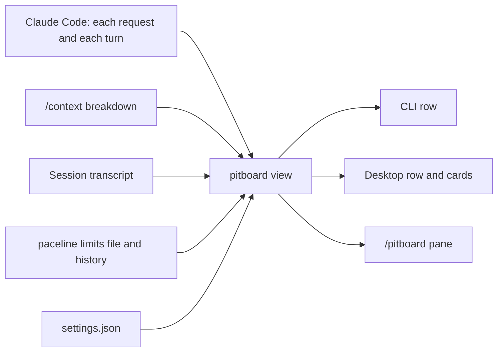

# How pitboard works

Where pitboard's numbers come from, how fresh they are, and how it computes Pace, Budget, and the
rest. For the list of readings and thresholds, see the [reference](reference.md).

## Where the numbers come from

pitboard computes nothing it cannot read. Claude Code reports usage to plugins with each reply, and
pitboard adds what paceline's limits file and the session's transcript hold.



| Reading | Source |
|---|---|
| Context | The token counts of each model request in the main conversation. After a compaction, the compaction's own size until `/context` can estimate the whole window, then that estimate until the next request. |
| Auto-compact, the compaction point, the compaction window and who set it | `/context`'s breakdown, read at session start, after each turn, and after each compaction. |
| Five-hour and weekly limits, API cost | Claude Code, once per turn, merged with the limits file when it exists. |
| Readings other sessions saw, the history behind Pace, model-scoped limits | paceline's limits file and its history, for the signed-in account only. |
| Cache countdown, `Hit` for the last turn | The session's own requests. The countdown runs from the start of the last one. |
| `Session` hits, the TTL | The session transcript since the last compaction. |
| Model, effort, Claude Code version, turns, session time | Claude Code. Until a request reports the effort, it comes from `modelSettings` or `effortLevel` in the settings. `/effort` in this session shows at once. |
| Advisor | `advisorModel` in `settings.json`. `/advisor` in this session shows at once. |
| Branch | `git branch --show-current` in the start directory. |

`/clear`, and a resume inside a running session, drop the previous conversation's context, cache, and
session readings at once. The limits stay, because they belong to the account. Subagents' requests and
compactions leave the row alone; it describes the main conversation.

## Where the row sits

The row sits where each surface lets a plugin draw:

- In the CLI, under the prompt input, below Claude Code's own mode and hint line. `ⓘ` and a `pitboard` button
  end it.
- In Desktop, above the prompt input. Desktop offers a plugin no place under the input: it does not
  draw the hint line that holds the CLI row. Its footer under the input, between the mode selector and
  the model name, has room for a short label only, and holds a `pitboard` button.

Either `pitboard` button opens the same pane as `/pitboard`. Claude Code counts the click as your
request, so the pane opens in a terminal of any width; a pane a plugin opens on its own waits for 144
columns.

## How fresh the numbers are

| Event | What pitboard refreshes |
|---|---|
| Each model request | Context, the cache countdown, `Hit`, effort |
| Each completed turn | Limits, cost, model, branch, the `/context` breakdown, the limits file, the transcript |
| Every 20 seconds | The limits file and `advisorModel` in `settings.json` |
| Every second | The clock behind countdowns, Pace, and time to reset |

A limit reading moves only while some session makes requests, because Claude Code reports limits after
each one. With every session idle, the five-hour and weekly readings stand still, unless paceline's
usage-watch is on. An idle session sees a reading from another session up to about 20 seconds after
paceline has written it to the file. A model switch, or an auto-compact change in `/config`, shows
after the next completed turn.

The Desktop row redraws only when what it shows changes. A card's paces and times are taken at the
start of the minute, so a card can lag by up to a minute.

### How the row combines the file with its own session

pitboard groups readings by window, by the reset time rounded to the minute:

- A later window wins, even with a lower reading.
- Within one window the higher reading wins, since a lower one can only be an older observation. On a
  tie the file's reading wins.
- A file reading observed more than 5 minutes ahead of the clock, or with a window that ends later
  than its length allows (5 hours or 7 days, plus 5 minutes), counts as absent.
- A window whose reset has passed reads 0%. The weekly window moves its reset forward by a week; the
  five-hour window has no known reset until a reading from the next window arrives.

### Model-scoped limits

The model-scoped weekly limits, such as `Fable`, exist only in the limits file. paceline's usage-watch
writes them with each exact reading of the account's usage, tagged `"source": "usage-endpoint"`.
pitboard shows them while both hold:

- The newest exact five-hour or weekly reading in the file is at most 15 minutes old.
- The week they were read in has not reset.

With usage-watch off, the file has no model-scoped limits and the row shows none.

## The formulas

### Pace

Pace is how fast a limit is spent now, in percent per hour. pitboard keeps a reading only when the
percentage changes, so each reading holds until the next one. Pace runs from the value held at the
start of a look-back span to the value now, and a flat stretch counts as time at zero. Pace is never
negative.

| Limit | Look-back | Minimum span before Pace shows |
|---|---|---|
| Five-hour | The last 90 minutes | 10 minutes of readings in this window |
| Weekly | The last 6 hours | 1 hour of readings in this window |

The weekly percentage moves in whole points, so its Pace needs a longer look-back. When the window
started inside the look-back, Pace runs from the window's first reading. Until the minimum span has
passed, Pace reads `n/a (needs 10 min)` or `n/a (needs 1 h)`.

### Budget, At reset, Runs out

```
Budget   = (100 - used %) / hours to reset
At reset = used % + Pace x hours to reset
Runs out = now + (100 - used %) / Pace hours
```

- Budget is the pace that spends exactly what is left by the reset.
- At reset is where the current Pace leaves the five-hour window at its reset.
- Runs out replaces At reset when the limit reaches 100% before the reset.

### The even-pace tick, Week elapsed, Spare and Overspent

The tick on a limit's bar stands at the share of the window gone: `1 - time to reset / window length`,
with a window of 5 hours or 7 days. For the week, the card calls this share Week elapsed.

```
Spare or Overspent (points) = used % - Week elapsed %
in hours of budget          = |points| / 100 x 168 h
```

Below even pace, the card says Spare; past it, Overspent. A week spends 100% over 168 hours, so a day
of budget is 100/7, about 14.3 points.

### Context and cache

- `Ctx` is the context's tokens divided by the compaction point while auto-compact is on, or by the
  full window while it is off, capped at 100%.
- `Turns left` divides what is left before compaction by the average growth of up to the last five
  turns that grew the context. It needs at least two of them. A drop in the context is a compaction
  and starts the series over.
- The cache countdown is the start of the last request plus the TTL, one hour or five minutes, less a
  5-second margin. Until a cache write shows the TTL, pitboard assumes five minutes. The hooks report
  how many tokens a request wrote to the cache but not their TTL, so after a request that writes the
  cache while the TTL is unknown, pitboard reads the transcript again every 2 seconds, up to five times.
- `If cold` uses the price ratio of a cache write to a cache read. A write costs 1.25 times the input
  price with a five-minute TTL and 2 times with a one-hour TTL. A read costs 0.05 times on Opus 5.5
  and Sonnet 5.5, 0.025 times on Fable 5.1 and Mythos 5.1, and 0.1 times on other models
  ([Anthropic, prompt caching prices](https://platform.claude.com/docs/en/build-with-claude/prompt-caching),
  read 2026-10-12). With a one-hour TTL a cold turn therefore costs about 40 times a warm one on Opus
  5.5 and Sonnet 5.5, and 80 times on Fable 5.1 and Mythos 5.1; with five minutes, 25 and 50 times.
  On another model pitboard divides by the 0.1 read price and marks the result `≥`: at least 20 or
  12.5 times.
- `Hit` is cache reads divided by reads plus writes.

## Why the row can differ from /usage

- `/usage` shows the account's figures at the moment you run it. The row shows the newest reading
  Claude Code reported to a session, or paceline recorded, and moves only when one arrives.
- Within one window the row keeps the higher of its own reading and the file's.
- The file holds the readings of each account apart. pitboard finds the signed-in account in
  Claude Code's `.claude.json` and draws that account's partition only, so a `/login` to another
  account changes the figures within about 20 seconds. When pitboard cannot tell the account, or the
  only readings have no account, it draws what the file has and shows `Account` `unknown` on the
  limit cards.
- The row rounds percentages to whole numbers.
- A Desktop card takes its paces and times at the start of the minute.
- Desktop's own context ring counts the full window. `Ctx` counts toward the compaction point while
  auto-compact is on, so it reads higher.

## What pitboard cannot see

The [limitations](limitations.md#data-pitboard-cannot-see) list what pitboard cannot see, with every other
limitation of pitboard.

## Colours

A colour means the same on every surface: the CLI row and detail line, the Desktop row and cards, and
the `/pitboard` pane.

| Colour | Meaning |
|---|---|
| None (grey) | Nothing to do. Good values stay grey too. |
| Amber | Watch: worth a glance. |
| Red | Act: changes what to do next. |
| Blue (teal in the terminal) | A cold cache: lost, and no longer urgent. |
| Green | A state that is on and fine: auto-compact on. |

Model and effort colours name the model and the effort level.

The terminal row, its detail line and the `/pitboard` pane draw in Claude Code's theme colours, so
they follow a light or a dark theme: values in the theme's `text`, names, separators and rules in
`inactive`, watch in `warning`, act in `error`, a cold cache in `planMode` (teal), and auto-compact on
in `success`. Model names take a theme colour by hue: Opus `autoAccept`, Sonnet `suggestion`, Fable
`bashBorder`, Haiku `success`; so do effort levels: low `warning`, medium `success`, high
`suggestion`, xhigh `autoAccept`, max `error`. Every text colour reaches a 4.5:1 contrast on Claude
Code's light and dark themes, except on the light theme Sonnet and effort high (`suggestion`, 4.4:1)
and Fable (`bashBorder`, 3.7:1). The Desktop row and cards keep their own fixed colours.

The five-hour limit turns red when its Pace is above its Budget. Budget is the pace that lasts exactly
to the reset, so a higher Pace reaches 100% before the reset: the same condition as Runs out. The row
also turns red from 90% used and amber from 70%.

The weekly limit and the model-scoped limits take their colour on the row from the percentage used
only: amber from 80%, red from 95%. Inside the Week card, Pace above Budget is amber, and Overspent is
amber, red past a day of budget.
